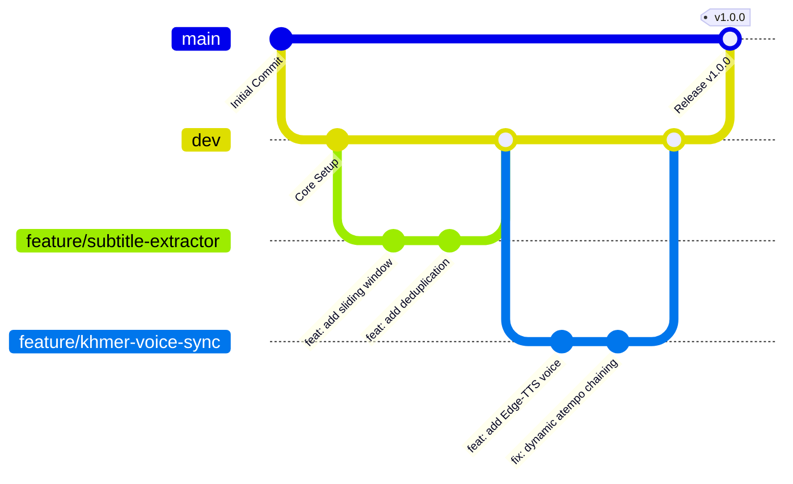

# 🔀 Git Workflow & Contribution Guide

This guide establishes the version control protocol, branching strategy, pull request rules, and commit standards for all team members contributing to the **Video Translate & Subtitle Studio** repository.

---

## 🌳 Branching Strategy

Our team employs a **Feature-Branch Workflow** anchored by two persistent branches:



### 1. Main Branches
- **`main`**: Production-ready branch. Must always be stable, tested, and runnable. Directly merged only by Team Lead (**Eang Panha**).
- **`dev`**: Active integration branch where features are combined before milestone releases.

### 2. Feature Branches
When beginning work on an assigned task, create a branch branched from `dev` or `main`:
- Format: `feature/<module-name>-<short-description>` or `fix/<bug-description>`
- Examples:
  - `feature/stt-sliding-window` (HIM Lihour)
  - `feature/khmer-voiceover-sync` (Vong Sokpheak)
  - `feature/player-controls` (NOK Sreylinh)
  - `fix/audio-daemon-hotplug` (VEASNA REAKSA)

---

## 📝 Commit Message Convention

All team members must follow the **Conventional Commits** specification:

```
<type>(<scope>): <short imperative description>
```

### Supported Types:
- **`feat`**: A new feature implemented in the code (e.g. `feat(tts): add dynamic atempo chaining`).
- **`fix`**: A bug fix (e.g. `fix(dubbing): prevent female voice fallback when male selected`).
- **`docs`**: Documentation changes (e.g. `docs(wiki): update team RACI matrix`).
- **`refactor`**: Code restructuring without changing functional behavior.
- **`test`**: Adding or updating tests.
- **`chore`**: Maintenance, dependency updates, or git configuration.

---

## 🔄 Pull Request (PR) & Code Review Checklist

Before any branch is merged into `main` or `dev`:

1. **Self-Review**:
   - Ensure the code follows PEP 8 formatting.
   - Verify that temporary files (`.mp3`, `.wav`, `.srt` artifacts) are not committed.
2. **Local Smoke Test**:
   - Run `./run.ps1` or `python main.py` and execute the 4-step dubbing process with a sample video.
   - Verify zero unhandled exceptions.
3. **Open Pull Request**:
   - Title: Clear description matching the commit convention.
   - Description: Reference the Task ID (e.g. `Closes VS-03`).
4. **Approval**:
   - At least 1 peer approval + sign-off from Team Lead (**Eang Panha**).
