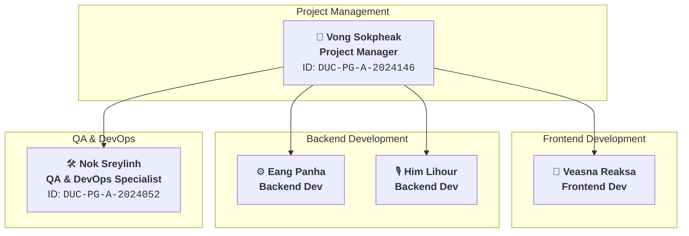
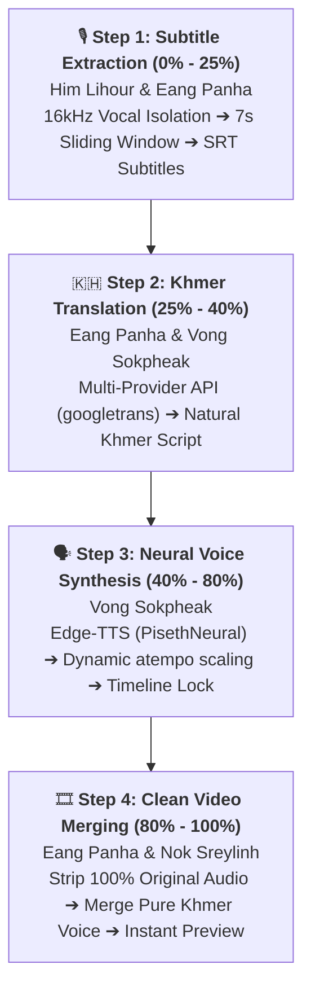

# 🎬 ក្រុម 9 - Video Translate & Subtitle Studio

> **University Assignment**: Department of Computer Science  
> **Group**: **ក្រុម 9 (Group 9)**  
> **Project Name**: AI-Powered Video Translation, Subtitle Extraction & Realtime Khmer Dubbing Studio  
> **Repository**: [cingcing12/AI_Tool](https://github.com/cingcing12/AI_Tool)

---

## 👥 សមាជិក និងតួនាទី (Group 9 Team Roster & Roles)

Official role distribution for **ក្រុម 9 (Group 9)** as assigned:



| ល.រ (No.) | ឈ្មោះ (Name) | អត្តលេខ (Student ID) | តួនាទីផ្លូវការ (Official Role) | ការទទួលខុសត្រូវស្នូល (Core Responsibilities) |
| :---: | :--- | :--- | :--- | :--- |
| **1** | **Vong Sokpheak** | `DUC-PG-A-2024146` | **Project Manager** | Project planning, timeline management, AI TTS neural dubbing architecture, team coordination & presentation. |
| **2** | **Veasna Reaksa** | — | **Frontend Dev** | Tkinter desktop GUI, Canvas cinema video player, YouTube double-click seeking (`-10s` / `+10s`), timeline scrubber & custom widgets. |
| **3** | **Eang Panha** | — | **Backend Dev** | FFmpeg video decoding pipeline, pure audio-video muxing (`-map 0:v:0 -map 1:a:0`), original sound removal, and multi-provider Khmer translation. |
| **4** | **Nok Sreylinh** | `DUC-PG-A-2024052` | **QA & DevOps Specialist** | System QA testing, test datasets (16:9, 9:16 vertical), Windows audio device routing daemon (`audio_daemon.ps1`), 1-click launchers (`run.bat`, `run.ps1`). |
| **5** | **Him Lihour** | — | **Backend Dev** | Speech-to-Text transcription engine, 16kHz vocal enhancement, 7s/5s sliding-window subtitle generation, and SRT timestamp formatter. |

---

## 🎯 Task Assignment Matrix (កាលវិភាគបែងចែកការងារ)

### 1. 👑 Vong Sokpheak (Project Manager)
- **Task PM-01**: Project scope definition, milestones planning, and team sprint oversight.
- **Task PM-02**: Neural voiceover synthesis pipeline using Microsoft Edge-TTS (`km-KH-PisethNeural` & `km-KH-SreymomNeural`).
- **Task PM-03**: Realtime speech synchronization algorithm with dynamic `atempo` chaining (zero syllable cutoff).
- **Task PM-04**: 100% male voice guarantee with pitch-shifted fallback (`asetrate=44100*0.82,atempo=1.22`).
- **Task PM-05**: Final project integration sign-off and presentation demo.

### 2. 🎨 Veasna Reaksa (Frontend Dev)
- **Task FE-01**: Build responsive desktop GUI layout in `main.py` using Tkinter with side controls and media viewport.
- **Task FE-02**: Develop cinema black viewport (`player_view.py`) with rounded corner masks and zero-glare frame.
- **Task FE-03**: Implement interactive playback controls: Play/Pause toggle, timeline scrubber, and seek indicator.
- **Task FE-04**: Build YouTube-style double-click skip (+10s right side, -10s left side).
- **Task FE-05**: Create reusable rounded cards, modern buttons, and animated progress bars (`widgets.py`).

### 3. ⚙️ Eang Panha (Backend Dev)
- **Task BE-01**: Implement FFmpeg in-memory RGB24 pipe decoding (25+ FPS streaming) in `video_engine.py`.
- **Task BE-02**: Multi-provider Khmer translation engine (`googletrans` authenticated session + `deep_translator` fallback) with 429 rate limit immunity.
- **Task BE-03**: Audio-video clean merge function (`merge_video`) that strips 100% of the original video audio and mounts pure Khmer voiceover.
- **Task BE-04**: Video aspect ratio probe and preservation logic (16:9, 9:16 vertical, 4:3, 1:1).

### 4. 🛠️ Nok Sreylinh (QA & DevOps Specialist)
- **Task QA-01**: Build Windows Media Foundation audio routing worker (`audio_daemon.ps1`) for seamless headphone/speaker hot-swapping.
- **Task QA-02**: Embed standalone Gyan FFmpeg 7.x portable binaries into `bin/ffmpeg.exe`.
- **Task QA-03**: Create 1-click execution scripts (`run.bat` and `run.ps1`) with automated `.venv` initialization.
- **Task QA-04**: Execute 9 end-to-end QA test cases (landscape videos, vertical Reels/TikTok, audio sync, male voice adherence).
- **Task QA-05**: Author User Manual, Installation Guide, and Troubleshooting Wiki documentation.

### 5. 🎙️ Him Lihour (Backend Dev)
- **Task BE-05**: Audio preprocessing pipeline: extract 16kHz mono audio with vocal isolation bandpass filtering.
- **Task BE-06**: Overlapping sliding-window transcription algorithm (7.0s window, 5.0s step) to capture speech boundaries.
- **Task BE-07**: Two-pass sub-slice recovery to prevent dropped subtitle segments in quiet or background-music moments.
- **Task BE-08**: SubRip (`.srt`) parser and formatter with exact millisecond timestamps (`HH:MM:SS,mmm`).
- **Task BE-09**: Prefix deduplication logic to seamlessly remove overlapping repeated words across speech chunks.

---

## 🏗️ របៀបដំណើរការប្រព័ន្ធ (4-Step Dubbing Pipeline)



---

## 🏃 Sprint Roadmap & Progress (កាលវិភាគ Sprint)

| Sprint | គោលដៅ (Focus Area) | ការទទួលខុសត្រូវ (Owners) | ស្ថានភាព (Status) |
| :---: | :--- | :--- | :---: |
| **Sprint 1** | Project Architecture, UI Layout & Video Player | Vong Sokpheak, Veasna Reaksa | `Completed` ✅ |
| **Sprint 2** | Audio Enhancement & Subtitle Extraction (`.srt`) | Him Lihour, Eang Panha | `Completed` ✅ |
| **Sprint 3** | Khmer Translation & Neural Voiceover (Man/Woman) | Vong Sokpheak, Eang Panha | `Completed` ✅ |
| **Sprint 4** | Realtime Timeline Sync & Clean Audio Replacement | Vong Sokpheak, Eang Panha | `Completed` ✅ |
| **Sprint 5** | QA Testing, Audio Daemon & Documentation | Nok Sreylinh, All Members | `In Progress` 🚀 |

---

## 🚀 ការដំឡើង និងដំណើរការ (Quick Start)

### 1-Click Launch (Windows):
```powershell
.\run.ps1
```
*Or double click `run.bat` in the project root directory.*
