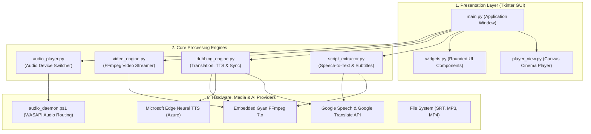
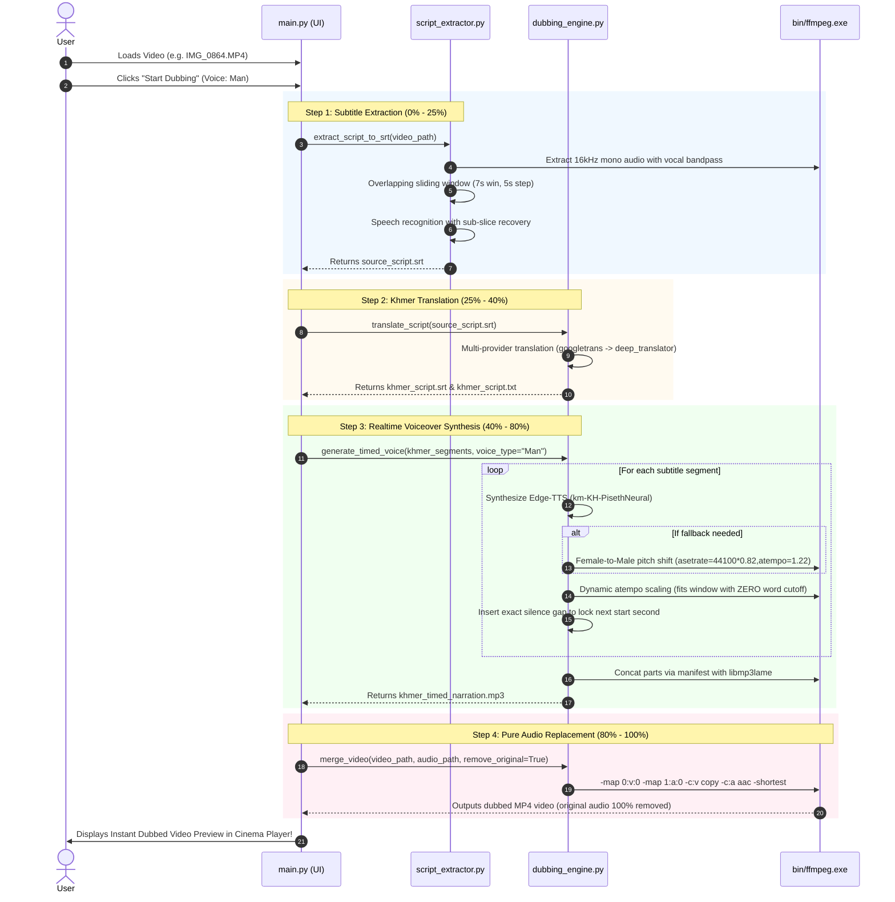

# 🏗️ System Architecture & Engineering Pipeline

This document details the underlying engineering architecture, mathematical algorithms, data processing flows, and modular design of the **Video Translate & Subtitle Studio**.

---

## 📐 High-Level Architecture Overview

The system is constructed with a modular layered architecture separating Presentation, Business Logic, and Multimedia IO.



---

## 🔄 End-to-End Dubbing & Video Pipeline

The video dubbing lifecycle progresses through four deterministic steps:



---

## 🧮 Mathematical Algorithms & Technical Innovations

### 1. Zero-Cutoff Dynamic `atempo` Chaining
When translating English speech into Khmer, the resulting Khmer sentence is often 20% - 40% longer in phonetic duration. In naive implementations, capping speedup or using hard `-t` cuts off final syllables.

Our algorithm calculates the exact required tempo multiplier:
$$\text{speedup} = \min\left(2.5, \max\left(1.0, \frac{\text{actual\_duration}}{\text{max\_available\_window} - 0.02}\right)\right)$$

Since FFmpeg's `atempo` filter is restricted to $[0.5, 2.0]$, the engine recursively chains filters:
$$\text{Filter Chain} = \underbrace{\text{atempo=2.0}, \dots}_{\lfloor \text{speedup} / 2.0 \rfloor \text{ times}}, \text{atempo}=\left(\frac{\text{speedup}}{2.0^k}\right)$$

This mathematical approach guarantees:
1. The voice finishes **before or exactly at** the start of the next subtitle.
2. **Zero words or syllables are clipped**.
3. Realtime video sync is maintained continuously across multi-minute videos.

### 2. Guaranteed 100% Male Voice Synthesis with Pitch-Shift Fallback
- **Primary Voice**: Microsoft Azure `km-KH-PisethNeural` (authentic deep male Cambodian voice).
- **Secondary Fallback**: If network interruptions occur, Google TTS (`gTTS`) generates raw audio. Because `gTTS` only provides a female voice for Khmer, the engine applies an acoustic pitch-frequency downshift:
  $$\text{FFmpeg Filter} = \texttt{-af "asetrate=44100*0.82,atempo=1.22"}$$
  This decreases formants and fundamental frequencies by 18% while restoring normal playback tempo, creating an authentic male voice and eliminating any jarring female voice switches.

### 3. Overlapping Sliding Window with Prefix Deduplication
To eliminate dropped words at chunk boundaries:
- Audio is read in **$7.0\text{s}$ windows** with a **$5.0\text{s}$ step** ($2.0\text{s}$ overlap).
- A two-pointer normalization algorithm compares the tail of the previous segment with the head of the current segment:
  $$\max_{k \le 14} \left( \text{Normalize}(\text{Tail}_{k}(\text{prev})) == \text{Normalize}(\text{Head}_{k}(\text{curr})) \right)$$
- If duplicate words are detected, they are trimmed cleanly.
- If a primary window returns empty due to quiet speech, a secondary pass splits the audio into focused $4.0\text{s}$ and $2.5\text{s}$ slices to capture the phrase.

---

## 📁 Source Code Organization

```
src/
├── core/
│   ├── audio_daemon.ps1      # Windows WASAPI background audio router
│   ├── audio_player.py       # High-level Python audio playback controller
│   ├── dubbing_engine.py     # Khmer translation, TTS synthesis & FFmpeg sync
│   ├── script_extractor.py   # Speech enhancement, sliding-window STT, SRT formatter
│   └── video_engine.py       # Pipe-based FFmpeg frame decoding & metadata extraction
└── ui/
    ├── player_view.py        # Tkinter Canvas video viewport & seek controllers
    └── widgets.py            # Modern rounded cards, buttons & progress bars
```
