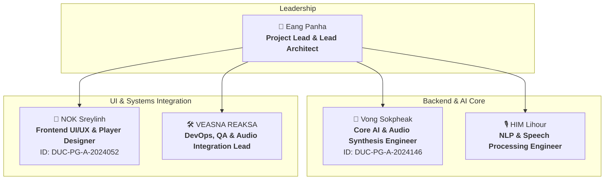
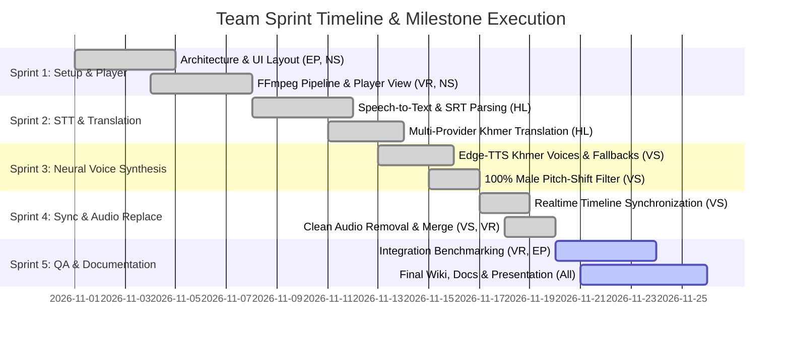

# 👥 Team Roles & Task Assignments

This document outlines the organization, division of labor, individual responsibilities, and assigned engineering tasks for the **Video Translate & Subtitle Studio** group assignment.

---

## 🏛️ Team Roster & Role Matrix

---

## 📋 Comprehensive RACI Matrix

- **R** = **Responsible** (Does the work to achieve the task)
- **A** = **Accountable** (Final approval and quality ownership)
- **C** = **Consulted** (Provides input and collaborates)
- **I** = **Informed** (Kept updated on progress)

| Project Module / Work Package | Eang Panha (Lead) | Vong Sokpheak | HIM Lihour | NOK Sreylinh | VEASNA REAKSA |
| :--- | :---: | :---: | :---: | :---: | :---: |
| **System Architecture & Design** | **A** | R | C | C | C |
| **Video Decoding & In-Memory Streaming** | A | C | I | R | C |
| **Speech-to-Text & Subtitle Extraction** | A | C | **R** | I | C |
| **Khmer Neural Translation Engine** | A | C | **R** | I | I |
| **Realtime Synchronized Khmer Voiceover** | A | **R** | C | I | I |
| **Audio-Video Clean Merging (FFmpeg)** | A | **R** | I | I | C |
| **Desktop UI / UX & Custom Widgets** | A | I | I | **R** | C |
| **Windows Audio Device Daemon (WASAPI)** | A | C | I | I | **R** |
| **Environment Packaging (UV, Batch, PS1)** | A | I | I | I | **R** |
| **Quality Assurance & Verification** | **A** | C | C | C | **R** |

---

## 🎯 Individual Task Assignments & Deliverables

### 1. 👑 Eang Panha (Project Lead & System Architect)
> **Primary Responsibility**: System Architecture, Code Review, Milestone Tracking, and Project Governance.

| Task ID | Task Description | Target Module | Status | Deliverables |
| :---: | :--- | :--- | :---: | :--- |
| **EP-01** | Define system requirements and high-level architectural specification. | Architecture | `Completed` | Project Spec Document & Architecture Diagram |
| **EP-02** | Review and merge Pull Requests across all feature branches into `main`. | Governance | `In Progress` | GitHub PR Approvals & Conflict Resolution |
| **EP-03** | Manage Sprint milestones, deadline adherence, and deliverables tracking. | Management | `In Progress` | GitHub Project Board & Milestones |
| **EP-04** | Lead final system integration testing, bug triage, and presentation demo. | Release | `Planned` | Slide Deck & Final Submission Video |

---

### 2. 🧠 Vong Sokpheak (Core AI & Audio Synthesis Engineer)
> **Student ID**: `DUC-PG-A-2024146`  
> **Primary Responsibility**: Neural TTS Dubbing Engine, Timeline Synchronization, and Audio-Video Merging.

| Task ID | Task Description | Target Module | Status | Deliverables |
| :---: | :--- | :--- | :---: | :--- |
| **VS-01** | Implement Edge-TTS neural voice synthesis for Khmer (`km-KH-PisethNeural` and `km-KH-SreymomNeural`). | `src/core/dubbing_engine.py` | `Completed` | Async TTS synthesis function |
| **VS-02** | Implement pitch-matched female-to-male fallback filter (`asetrate=44100*0.82,atempo=1.22`) to guarantee 100% male voice adherence. | `src/core/dubbing_engine.py` | `Completed` | Pitch shifting filter pipeline |
| **VS-03** | Engineer realtime timeline synchronization algorithm with gap padding and dynamic `atempo` chaining (zero word cutoff). | `src/core/dubbing_engine.py` | `Completed` | `generate_timed_voice` with dynamic atempo |
| **VS-04** | Implement clean FFmpeg audio-video muxing (`-map 0:v:0 -map 1:a:0`) to remove original audio 100% and insert Khmer voiceover. | `src/core/dubbing_engine.py` | `Completed` | `merge_video` function |
| **VS-05** | Benchmark audio-visual synchronization on 16:9 and 9:16 vertical short videos. | Testing | `In Progress` | Sync validation report |

---

### 3. 🎙️ HIM Lihour (NLP & Speech Processing Engineer)
> **Primary Responsibility**: Speech-to-Text Transcription, Audio Filtering, Subtitle Parsing, and Khmer Translation.

| Task ID | Task Description | Target Module | Status | Deliverables |
| :---: | :--- | :--- | :---: | :--- |
| **HL-01** | Develop 16kHz mono speech enhancement filter with bandpass vocal isolation for transcription. | `src/core/script_extractor.py` | `Completed` | Audio preprocessing pipeline |
| **HL-02** | Implement 7.0s overlapping sliding window transcription with prefix deduplication algorithm. | `src/core/script_extractor.py` | `Completed` | `_transcribe_speech_recognition` |
| **HL-03** | Build two-pass sub-slice recovery to prevent dropped subtitle segments in quiet or music-heavy audio. | `src/core/script_extractor.py` | `Completed` | Sub-window fallback parser |
| **HL-04** | Integrate multi-provider Khmer translation (`googletrans` authenticated session + `deep_translator` fallback) with 429 rate limit immunity. | `src/core/dubbing_engine.py` | `Completed` | `translate_text_to_khmer` |
| **HL-05** | Format and validate standard SubRip (`.srt`) timestamps (`HH:MM:SS,mmm`). | `src/core/script_extractor.py` | `Completed` | SRT parser & formatter |

---

### 4. 🎨 NOK Sreylinh (Frontend UI/UX & Media Player Designer)
> **Student ID**: `DUC-PG-A-2024052`  
> **Primary Responsibility**: Desktop GUI Design, Canvas Video Player, Controls, and Interactive Progress Display.

| Task ID | Task Description | Target Module | Status | Deliverables |
| :---: | :--- | :--- | :---: | :--- |
| **NS-01** | Design clean modern desktop UI layout with responsive side control panel and video preview. | `main.py`, `src/ui/` | `Completed` | Application main window layout |
| **NS-02** | Develop YouTube/VLC-style media viewport (`player_view.py`) with cinema black background and corner masks. | `src/ui/player_view.py` | `Completed` | Custom Tkinter Canvas Video Player |
| **NS-03** | Implement interactive playback controls: Play/Pause toggle, double-click skip (`-10s` / `+10s`), and timeline scrubber. | `src/ui/player_view.py` | `Completed` | Seeking and skip event handlers |
| **NS-04** | Build reusable custom Tkinter UI components (`RoundedCard`, `RoundedButton`, `RoundedProgressBar`). | `src/ui/widgets.py` | `Completed` | Modular widgets package |
| **NS-05** | Implement thread-safe UI update queue and 4-step progress bar notifications. | `main.py` | `Completed` | Safe GUI thread progress bridge |

---

### 5. 🛠️ VEASNA REAKSA (DevOps, QA & Systems Integration Lead)
> **Primary Responsibility**: Windows Audio Device Hot-Swapping, FFmpeg Distribution, Packaging, and QA Testing.

| Task ID | Task Description | Target Module | Status | Deliverables |
| :---: | :--- | :--- | :---: | :--- |
| **VR-01** | Engineer background WASAPI audio daemon in PowerShell (`audio_daemon.ps1`) for seamless headphone/speaker hot-swapping. | `src/core/audio_daemon.ps1` | `Completed` | Background audio routing script |
| **VR-02** | Embed standalone Gyan FFmpeg 7.x portable binaries into `bin/` with automated PATH discovery. | `bin/ffmpeg.exe` | `Completed` | Portable FFmpeg bundle |
| **VR-03** | Create 1-click execution scripts (`run.bat` and `run.ps1`) with automatic virtual environment initialization. | `run.bat`, `run.ps1` | `Completed` | One-click launch scripts |
| **VR-04** | Design comprehensive test suite with diverse video formats (MP4, MKV, MOV, vertical reels). | `tests/` | `In Progress` | Test suite & sample video fixtures |
| **VR-05** | Author User Manual, Installation Guide, and Troubleshooting Wiki documentation. | `wiki/` | `Completed` | Wiki manuals & FAQs |

---

## 📊 Sprint Velocity & Progress Summary

