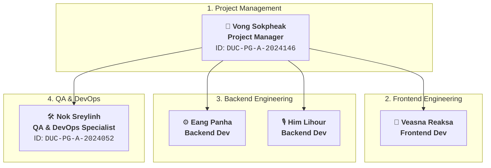

# 👥 ក្រុម 9 - Team Roles & Task Assignments

This document outlines the organization, division of labor, individual responsibilities, and assigned engineering tasks for **ក្រុម 9 (Group 9)** in the **Video Translate & Subtitle Studio** project.

---

## 🏛️ Team Roster & Role Structure

---

## 📋 Comprehensive RACI Matrix (ក្រុម 9)

- **R** = **Responsible** (Does the work to achieve the task)
- **A** = **Accountable** (Final approval and quality ownership)
- **C** = **Consulted** (Provides input and collaborates)
- **I** = **Informed** (Kept updated on progress)

| Project Work Package | Vong Sokpheak (PM) | Veasna Reaksa (FE) | Eang Panha (BE) | Nok Sreylinh (QA/DevOps) | Him Lihour (BE) |
| :--- | :---: | :---: | :---: | :---: | :---: |
| **Project Planning & Governance** | **A / R** | C | C | C | C |
| **Desktop UI / UX & Custom Widgets** | A | **R** | I | C | I |
| **Cinema Player (Canvas Viewport)** | A | **R** | C | I | I |
| **In-Memory FFmpeg Video Streaming** | A | C | **R** | I | I |
| **Speech-to-Text & Subtitle Extraction** | A | I | C | I | **R** |
| **Khmer Neural Translation Engine** | A | I | **R** | I | C |
| **Neural Voiceover Synthesis (Edge-TTS)** | **A / R** | I | C | I | I |
| **Realtime Audio Timeline Sync** | **A / R** | I | C | I | I |
| **Clean Audio Replacement & Merge** | A | I | **R** | I | I |
| **Windows WASAPI Audio Daemon** | A | I | I | **R** | I |
| **DevOps & 1-Click Launchers** | A | I | I | **R** | I |
| **Quality Assurance & Test Suite** | A | C | C | **R** | C |

---

## 🎯 Individual Task Breakdown & Deliverables

### 1. 👑 Vong Sokpheak (Project Manager)
> **Student ID**: `DUC-PG-A-2024146`  
> **Core Role**: Project Management, AI Dubbing Architecture & Audio Timeline Synchronization.

| Task ID | Task Description | Target File / Module | Status | Deliverables |
| :---: | :--- | :--- | :---: | :--- |
| **PM-01** | Define project scope, milestone timelines, and coordinate team sprint tasks. | Management | `Completed` | Sprint planning & task matrix |
| **PM-02** | Implement Edge-TTS neural voice synthesis (`km-KH-PisethNeural` and `km-KH-SreymomNeural`). | `src/core/dubbing_engine.py` | `Completed` | Async Edge-TTS engine |
| **PM-03** | Engineer realtime timeline synchronization with dynamic `atempo` chaining (zero word cutoff). | `src/core/dubbing_engine.py` | `Completed` | `generate_timed_voice` with dynamic atempo |
| **PM-04** | Implement female-to-male pitch shift fallback (`asetrate=44100*0.82,atempo=1.22`) to guarantee 100% pure male voice. | `src/core/dubbing_engine.py` | `Completed` | Male pitch shift pipeline |
| **PM-05** | Final system integration sign-off, conflict resolution, and presentation demo. | Governance | `In Progress` | Final project release & demo |

---

### 2. 🎨 Veasna Reaksa (Frontend Dev)
> **Core Role**: Desktop UI/UX, Custom Widgets, Media Viewport & Player Controls.

| Task ID | Task Description | Target File / Module | Status | Deliverables |
| :---: | :--- | :--- | :---: | :--- |
| **FE-01** | Design clean modern Tkinter layout with responsive side control panel and video preview. | `main.py`, `src/ui/` | `Completed` | Main application layout |
| **FE-02** | Develop YouTube/VLC-style media viewport (`player_view.py`) with cinema black background. | `src/ui/player_view.py` | `Completed` | Canvas cinema video player |
| **FE-03** | Implement interactive controls: Play/Pause toggle, timeline scrubber, and seek indicator. | `src/ui/player_view.py` | `Completed` | Interactive playback controls |
| **FE-04** | Build YouTube-style double-click skip (+10s right side, -10s left side). | `src/ui/player_view.py` | `Completed` | Double-click skip handler |
| **FE-05** | Build reusable custom components (`RoundedCard`, `RoundedButton`, `RoundedProgressBar`). | `src/ui/widgets.py` | `Completed` | Custom widget package |

---

### 3. ⚙️ Eang Panha (Backend Dev)
> **Core Role**: FFmpeg Video Streaming, Video Merging & Khmer Translation.

| Task ID | Task Description | Target File / Module | Status | Deliverables |
| :---: | :--- | :--- | :---: | :--- |
| **BE-01** | Implement in-memory FFmpeg RGB24 frame streaming (25+ FPS pipe) in `video_engine.py`. | `src/core/video_engine.py` | `Completed` | Frame decoder engine |
| **BE-02** | Build multi-provider Khmer translation engine (`googletrans` + `deep_translator`) with 429 rate limit immunity. | `src/core/dubbing_engine.py` | `Completed` | `translate_text_to_khmer` |
| **BE-03** | Implement clean FFmpeg audio-video muxing (`-map 0:v:0 -map 1:a:0`) removing 100% original sound. | `src/core/dubbing_engine.py` | `Completed` | `merge_video` function |
| **BE-04** | Develop dynamic aspect ratio probe and preservation logic (16:9, 9:16 vertical, 4:3, 1:1). | `src/core/video_engine.py` | `Completed` | Aspect ratio math logic |

---

### 4. 🛠️ Nok Sreylinh (QA & DevOps Specialist)
> **Student ID**: `DUC-PG-A-2024052`  
> **Core Role**: DevOps Packaging, Audio Routing Daemon, Testing & User Documentation.

| Task ID | Task Description | Target File / Module | Status | Deliverables |
| :---: | :--- | :--- | :---: | :--- |
| **QA-01** | Build background WASAPI audio routing worker (`audio_daemon.ps1`) for headphone/speaker switching. | `src/core/audio_daemon.ps1` | `Completed` | Audio device routing daemon |
| **QA-02** | Embed standalone Gyan FFmpeg 7.x portable binaries into `bin/ffmpeg.exe`. | `bin/ffmpeg.exe` | `Completed` | Portable FFmpeg bundle |
| **QA-03** | Create 1-click execution scripts (`run.bat` and `run.ps1`) with automatic `.venv` setup. | `run.bat`, `run.ps1` | `Completed` | One-click launch scripts |
| **QA-04** | Execute end-to-end QA test suite across diverse video formats (MP4, MKV, vertical Reels). | `tests/` | `In Progress` | Test reports & fixtures |
| **QA-05** | Author User Manual, Installation Guide, and Troubleshooting Wiki documentation. | `wiki/` | `Completed` | Wiki manuals & FAQs |

---

### 5. 🎙️ Him Lihour (Backend Dev)
> **Core Role**: Audio Extraction, Speech-to-Text Transcription & Subtitle Formatting.

| Task ID | Task Description | Target File / Module | Status | Deliverables |
| :---: | :--- | :--- | :---: | :--- |
| **BE-05** | Build 16kHz mono audio extraction with vocal isolation bandpass filtering for clear STT. | `src/core/script_extractor.py` | `Completed` | Audio enhancement filter |
| **BE-06** | Implement 7.0s overlapping sliding-window transcription (5.0s step) to capture speech boundaries. | `src/core/script_extractor.py` | `Completed` | Sliding window STT |
| **BE-07** | Build two-pass sub-slice recovery to prevent dropped subtitle segments in quiet or music moments. | `src/core/script_extractor.py` | `Completed` | Sub-slice fallback parser |
| **BE-08** | Implement SubRip (`.srt`) parser and formatter with exact millisecond timestamps (`HH:MM:SS,mmm`). | `src/core/script_extractor.py` | `Completed` | SRT timestamp formatter |
| **BE-09** | Engineer prefix deduplication algorithm to eliminate repeated boundary words. | `src/core/script_extractor.py` | `Completed` | Prefix deduplication function |
